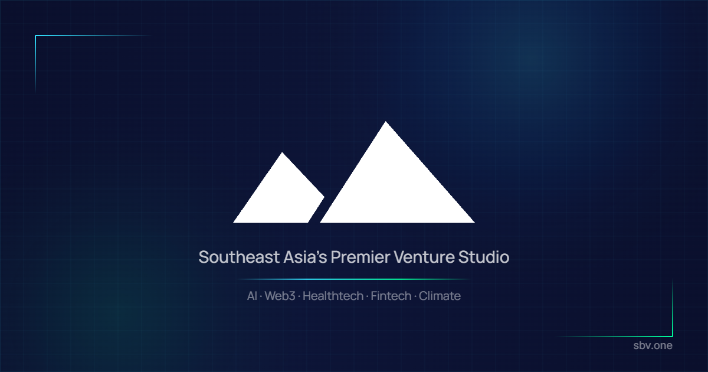

# Starting Block Ventures — sbv.one

[](LICENSE)


Marketing site for **Starting Block Ventures**, a Philippine venture studio that co-builds and scales early-stage startups. It presents the studio, its venture portfolio and programs (Pitch, InSpace, FutureCare Accelerator), takes founder applications, contact messages and newsletter sign-ups, and includes a small password-protected admin dashboard for reviewing submissions. Built with the Next.js App Router, Prisma/PostgreSQL, NextAuth and Nodemailer.

**Live site:** [sbv.one](https://sbv.one)



## Features

- **Public pages** — home (scroll-driven hero frame animation), About, Ventures, Pitch, InSpace, FutureCare Accelerator, Apply, Contact, and Legal / Terms / Privacy.
- **Forms with persistence and email** — `/api/apply`, `/api/contact` and `/api/newsletter` validate input with Zod and store it via Prisma; apply and contact also send notification emails with Nodemailer and React Email templates. The contact form uses a honeypot field and a minimum-fill-time check against spam.
- **Admin dashboard** — `/admin` sign-in (NextAuth credentials, bcrypt-hashed passwords) and `/admin/dashboard` to list, mark read and delete applications and contact messages via `/api/admin/submissions`.
- **Hardening** — middleware protects the admin routes and rate-limits the public API routes; `next.config.ts` sets security headers (HSTS, `X-Frame-Options`, `nosniff`, etc.).
- **SEO** — Open Graph / Twitter metadata, `sitemap.ts`, `robots.ts`, and an in-browser OG image generator at `/og-generator`.

## Getting Started

Requirements: Node.js 20+ and a PostgreSQL database.

```bash
npm install
cp .env.example .env        # then fill in the values below
npx prisma db push          # create the tables from prisma/schema.prisma
npm run seed                # creates the admin account and prints a one-time password
npm run dev
```

Open [http://localhost:3000](http://localhost:3000) with your browser to see the result.

### Environment variables

| Variable | Purpose |
|---|---|
| `DATABASE_URL` | PostgreSQL connection string |
| `NEXTAUTH_SECRET` | NextAuth signing secret (`openssl rand -base64 32`) |
| `NEXTAUTH_URL` | Base URL of the site, e.g. `http://localhost:3000` |
| `SMTP_HOST`, `SMTP_PORT`, `SMTP_USER`, `SMTP_PASSWORD`, `SMTP_FROM` | SMTP settings for notification emails |

See [`.env.example`](.env.example). Never commit a real `.env`.

### Scripts

| Command | What it does |
|---|---|
| `npm run dev` | Start the development server |
| `npm run build` | Production build |
| `npm run start` | Serve the production build |
| `npm run lint` | ESLint (`eslint-config-next`) |
| `npm test` | Run the Vitest suite once |
| `npm run test:watch` | Vitest in watch mode |
| `npm run seed` | Create the admin user (`prisma/seed.ts`) |

## Project Structure

```
prisma/
  schema.prisma     Application, Contact, Newsletter, Admin models
  seed.ts           admin account seed
public/
  frames/           hero animation frames (WebP)
  icons/, venture-imgs/, sbv_logo*   brand and portfolio assets
src/
  app/              App Router pages, layouts, sitemap/robots
    api/            apply, contact, newsletter, admin/submissions, auth
    admin/          sign-in and dashboard
  components/       page sections (Header, Hero, Portfolio, Footer, ...)
  emails/           React Email templates
  lib/              auth options, mailer, Prisma client
  middleware.ts     admin protection + API rate limiting
  __tests__/        Vitest tests (validation, auth, email)
```

## Deploy

The site is set up for [Vercel](https://vercel.com/new). Set the environment variables above in the project settings and point `DATABASE_URL` at a hosted PostgreSQL instance. See the [Next.js deployment documentation](https://nextjs.org/docs/app/building-your-application/deploying) for details.

## License

Code released under the [MIT License](LICENSE). MIT covers the code; the Starting Block Ventures name and logo identify the project, and portfolio company logos belong to their respective owners.
